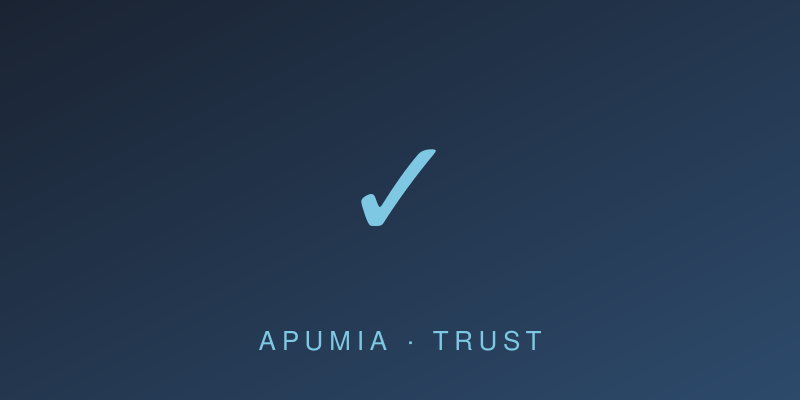

# Apumia Trust

**Ed25519 Trust Stamp для LLM. Регулятор проверяет подпись публично, не заходя в систему банка.**

---

## За 30 секунд

**Что это:** PUMA фильтрует вход (injection, PII), BEE проверяет выход (утечки), Trust Authority выдаёт Ed25519-подписанный Trust Stamp с SHA-256 audit hash.

**Кому:** CCO / MLRO / CTO в банке и финтехе (AIFC, MAS, PDPL).

**Почему сейчас:** MAS требует независимой проверки. Self-attestation не считается. Trust Stamp — артефакт, который регулятор проверяет сам, без доступа к банку.

**Что доказано:** 38 passed. Реальная подпись Ed25519, tamper detection (hash_mismatch на подмену), публичная верификация через /v1/verify и standalone_verify.py. apumia prove → PROVEN.

**Чего не доказано (честно):** 0 клиентов. ФСТЭК/152-ФЗ — не в коробке. NER (spacy) — опционален.

---

## Оффер

PoC $15–25K: полный код, 38 тестов, 30 дней интеграции.

**Следующий шаг:** 20-минутный звонок — покажу живую верификацию подписи, без слайдов.

---

## GitHub

- **Private code:** apumiaaifund/apumia-trust
- **Public demo:** apumiaaifund/apumia-trust-demo

## License

MIT

---

### 🚀 Что мы можем реализовать для партнёров на основе этого решения (Ниши и сценарии)

- **Системные интеграторы и ИИ-вендоры:** выпуск криптографических штампов доверия на отчёты, модели и артефакты.
- **B2B-маркетплейсы и ЭДО:** подтверждение целостности и авторства цифровых документов без привязки к одному облаку.

> **Формат сотрудничества:** запуск пилотного стенда (PoC) за 2–4 недели, лицензирование модуля (On-Premise) или кастомная интеграция под стек заказчика.  
> 📬 **Запросить демонстрацию и расчёт пилота:** [apumiaaifund@gmail.com](mailto:apumiaaifund@gmail.com)

---

### 🛡️ Верификация качества и безопасности (Apumia DevSecOps Gate)

> **Статус:** `VERIFIED & PROVEN` • **Дата аудита:** `16.11.2026`  
> **Контроль архитектуры (`Apumia Blueprint`):** `CLEAN` (`0` циклических зависимостей, контроль сложности McCabe)  
> **Анализ безопасности (`Bandit / Zero-Trust`):** `0` критических уязвимостей  
> **Протокол достоверности (`Apumia Hub`):** `_synthetic: false` | `preservation: 100.0%` | `verified: true`
